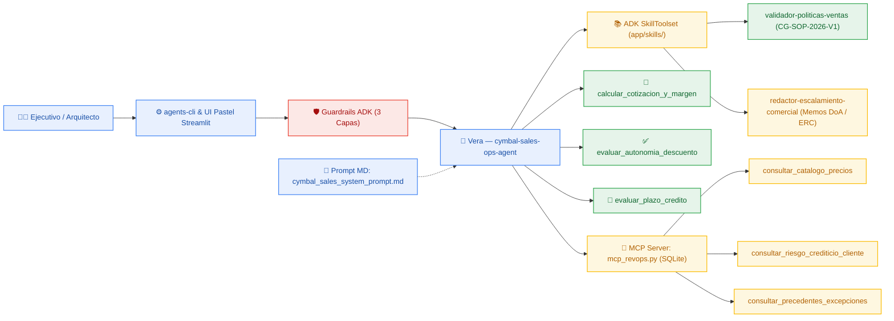

# ☁️ Cymbal Sales Ops with ADK — Hands-On Lab Completo (`Antigravity` + `agents-cli` + Google ADK)

<p align="center">
  
</p>

<p align="center">
  <em>Conoce a <strong>Vera</strong> — Concierge Ejecutiva de Operaciones de Ventas (Sales Ops &amp; RevOps) y Gobernanza Comercial de <strong>Cymbal Group</strong>, diseñada en <strong>colores de Google Cloud y tonos pasteles</strong> con <strong>Google Antigravity</strong>, el <strong>Google Agent Development Kit (ADK)</strong> y <a href="https://google.github.io/agents-cli/">Google Agents CLI (<code>agents-cli</code>)</a>.</em>
</p>

<p align="center">
  <a href="https://shell.cloud.google.com/cloudshell/editor?cloudshell_git_repo=https://github.com/aquevedos/antigravity-example-latam&cloudshell_tutorial=README.md">
    
  </a>
</p>

> 💡 **¿Quieres hacer el laboratorio 100% desde tu navegador en Google Cloud Shell?** Haz clic en el botón **"Open in Cloud Shell"** superior (abrirá la terminal autenticada en tu cuenta de Google Cloud con este tutorial interactivo al costado) o abre tu terminal local y comienza en el **Módulo 0**.

---

## 🗺️ Mapa del Taller: El Ciclo de Vida Completo en 7 Pasos (Sin Marearse)

Este laboratorio sigue el orden natural de ingeniería de agentes empresariales en Google Cloud, desde el plano en papel hasta su publicación en **Gemini Enterprise**:

```mermaid
flowchart LR
    S0["0️⃣ Setup CLI"] --> S1["1️⃣ spec.md (Plano)"]
    S1 --> S2["2️⃣ scaffold + .env"]
    S2 --> S3["3️⃣ build & UI Pastel"]
    S3 --> S4["4️⃣ eval (Golden Dataset)"]
    S4 --> S5["5️⃣ observability (Trace)"]
    S5 --> S6["6️⃣ deploy + Terraform IaC"]
    S6 --> S7["7️⃣ publish (Gemini Enterprise)"]

    classDef bluePastel fill:#E8F0FE,stroke:#4285F4,stroke-width:1.5px,color:#174EA6;
    classDef greenPastel fill:#E6F4EA,stroke:#34A853,stroke-width:1.5px,color:#0D652D;
    classDef yellowPastel fill:#FEF7E0,stroke:#FBBC05,stroke-width:1.5px,color:#B06000;
    classDef redPastel fill:#FCE8E6,stroke:#EA4335,stroke-width:1.5px,color:#A50E0E;

    class S0,S1,S2 bluePastel;
    class S3,S6,S7 greenPastel;
    class S4,S5 yellowPastel;
```



| Módulo | Etapa | En palabras simples | Archivo / Comando Clave |
| :---: | :--- | :--- | :--- |
| **0** | **`setup`** | Prepara las herramientas (`uv`, `agents-cli`, `gcloud`, `terraform`). | [`scripts/setup_agents_cli.sh`](./scripts/setup_agents_cli.sh) |
| **1** | **`spec.md`** | **El Plano del Arquitecto:** define rol, reglas, herramientas y UI pastel antes de programar. | [`spec.md`](./spec.md) |
| **2** | **`scaffold` + `.env`** | **Los Cimientos y las Llaves:** crea la carpeta base ADK y conecta tus credenciales GCP. | `agents-cli scaffold create` + `agents-cli-env` |
| **3** | **`build` & `run`** | **El Cerebro y la Pantalla:** construye a Vera (con `@spec.md` o desde [`starter/`](./starter/)) y pruébala en consola, ADK Web y Streamlit Pastel. | [`starter/agent.py`](./starter/agent.py), [`mcp_revops.py`](./starter/mcp_revops.py), [`ui.py`](./starter/ui.py) |
| **4** | **`eval` & `lint`** | **El Examen de Calidad:** califica automáticamente a Vera con un *Golden Dataset* (*LLM-as-a-Judge*). | `agents-cli eval run` ([`basic-dataset.json`](./starter/basic-dataset.json)) |
| **5** | **`observability`** | **Rayos X y Auditoría:** inspecciona trazas OpenTelemetry en **Cloud Trace**, **Cloud Logging** y **BigQuery**. | `Cloud Trace` / `agents-cli infra single-project` |
| **6** | **`deploy` (IaC)** | **Subida a la Nube:** genera **Terraform IaC** declarativo y despliega en **Vertex AI Agent Runtime**. | `agents-cli scaffold enhance` + `agents-cli deploy` |
| **7** | **`publish`** | **Vitrina Empresarial:** verifica **Agent Registry** y conecta a Vera en **Gemini Enterprise**. | `agents-cli publish gemini` |

---

## 🧭 Arquitectura Interna de Vera (`cymbal-sales-ops-agent`)

Vera resuelve cuellos de botella en el proceso *Quote-to-Cash* de **Cymbal Group**: valida descuentos por volumen, protege el piso innegociable de margen bruto del `25.0%`, evalúa plazos de crédito `Net 30/60/90` y redacta memorandos ejecutivos de escalamiento bajo la política `CG-SOP-2026-V1`.



| Capa en el Proyecto | Archivo en el Repo | Qué hace |
| :--- | :--- | :--- |
| **Plano Arquitectónico (`Spec-Driven`)** | [`spec.md`](./spec.md) | Contrato técnico para **Google Antigravity** (`@spec.md`): rol, políticas, herramientas, UI pastel y casos de prueba. |
| **Guardrails de 3 Capas** | [`starter/agent.py`](./starter/agent.py) | `guardrail_entrada_comercial` (`before_model_callback`), `guardrail_parametros_herramientas` (`before_tool_callback`) y `SafetySetting`. |
| **System Prompt Modular** | [`starter/prompts/cymbal_sales_system_prompt.md`](./starter/prompts/cymbal_sales_system_prompt.md) | Personalidad ejecutiva de **Vera**, reglas *Zero Hallucination* y orden de llamada a herramientas. |
| **ADK Runtime Skills (`SkillToolset`)** | [`starter/skills/validador-politicas-ventas/`](./starter/skills/validador-politicas-ventas/SKILL.md) y [`redactor-escalamiento-comercial/`](./starter/skills/redactor-escalamiento-comercial/SKILL.md) | Normativa oficial `CG-SOP-2026-V1` y plantillas de memorandos para VP Regional, Finanzas y Comité *ERC*. |
| **Tools Financieras Deterministas** | [`starter/agent.py`](./starter/agent.py) | `calcular_cotizacion_y_margen`, `evaluar_autonomia_descuento` y `evaluar_plazo_credito` (cero cálculo mental del LLM). |
| **Servidor MCP Local (SQLite)** | [`starter/mcp_revops.py`](./starter/mcp_revops.py) | Catálogo MSRP/COGS, buró de riesgo crediticio e historial de excepciones en SQLite parametrizado. |
| **Interfaz Pastel Google Cloud** | [`starter/ui.py`](./starter/ui.py) | Consola en **Streamlit** con paleta pastel de Google Cloud (`#E8F0FE`, `#E6F4EA`, `#FEF7E0`, `#FCE8E6`) y botones en 1 clic. |

---

## Módulo 0 (`setup`): Preparación del Entorno

Instala y configura automáticamente `uv`, Python 3.11+, Node/`npx`, `gcloud`, `terraform`, `agents-cli`, `mcp` y `streamlit` (detecta si estás en **Google Cloud Shell**, Linux o macOS):

* **Opción 1 — Si ya estás dentro del repositorio clonado (Local o Cloud Shell):**
  ```bash
  export LAB_REPO="$(pwd)"
  bash scripts/setup_agents_cli.sh
  source ~/.bashrc  # o source ~/.zshrc en macOS
  ```

* **Opción 2 — Sin clonar en 1 línea vía `curl` (requiere repositorio `Public` en GitHub):**
  ```bash
  bash <(curl -fsSL https://raw.githubusercontent.com/aquevedos/antigravity-example-latam/main/scripts/setup_agents_cli.sh)
  source ~/.bashrc  # o source ~/.zshrc en macOS
  ```

> [!IMPORTANT]
> **¿Te apareció `curl: (22) The requested URL returned error: 404`?**
> En GitHub, los enlaces `raw.githubusercontent.com/...` devuelven **`404`** mientras el repositorio esté configurado como **`Private`**. Si ya tienes la carpeta localmente usa la **Opción 1** (`bash scripts/setup_agents_cli.sh`), o cambia la visibilidad del repositorio a **`Public`** en GitHub (**Settings** $\rightarrow$ **General** $\rightarrow$ **Danger Zone** $\rightarrow$ **Change repository visibility** $\rightarrow$ **Change to Public**).

---

## Módulo 1 (`spec.md`): El Plano del Arquitecto (*Spec-Driven Development*)

Antes de crear código, todo agente empresarial parte de una especificación clara ([`spec.md`](./spec.md)): allí se definen las reglas de negocio (`CG-SOP-2026-V1`), el piso del `25.0%` de margen bruto, las integraciones MCP, los colores pasteles de Google Cloud y los escenarios de validación.

*(En el siguiente módulo copiaremos este `spec.md` directamente dentro de la carpeta de tu proyecto).*

---

## Módulo 2 (`scaffold` + `.env`): Cimientos del Proyecto y Credenciales

1. Crea la estructura oficial del proyecto **`cymbal-sales-ops-agent`** y copia el plano `spec.md` (detecta tu clon local automáticamente o descarga desde GitHub):
   ```bash
   LAB_REPO="${LAB_REPO:-$(for d in "$PWD" "$HOME/cloudshell_open/antigravity-example-latam" "$HOME/codelabs-practica/antigravity-example-latam" "$HOME/antigravity-example-latam"; do [ -f "$d/spec.md" ] && echo "$d" && break; done)}"
   cd ~
   agents-cli scaffold create cymbal-sales-ops-agent --prototype --yes
   cd cymbal-sales-ops-agent
   if [ -n "$LAB_REPO" ]; then cp "$LAB_REPO/spec.md" spec.md; else curl -fsSL https://raw.githubusercontent.com/aquevedos/antigravity-example-latam/main/spec.md -o spec.md; fi
   ```

2. Configura las credenciales (`.env` y `app/.env`) eligiendo **una** opción:
   * **Opción A — Google Cloud / Vertex AI (Recomendada en Cloud Shell y Empresas):**
     ```bash
     # Detecta automáticamente tu proyecto ($DEVSHELL_PROJECT_ID) y habilita las APIs necesarias
     agents-cli-env vertex "${GOOGLE_CLOUD_PROJECT:-$DEVSHELL_PROJECT_ID}" global
     ```
   * **Opción B — Google AI Studio (`GEMINI_API_KEY`):**
     ```bash
     agents-cli-env aistudio TU_CLAVE_DE_AI_STUDIO_AQUI
     ```

---

## Módulo 3 (`build` & `run`): Construir y Probar a Vera (ADK + MCP + UI Pastel)

Puedes construir a **Vera** de dos maneras (ambas producen la misma arquitectura en `app/`):

* **Ruta A — Con Google Antigravity (*Spec-Driven*):** Abre la carpeta `~/cymbal-sales-ops-agent` en Antigravity (el paso `setup_agents_cli.sh` ya sincronizó la skill `cymbal-sales-ops-adk` en `~/.agents/skills/`) y escribe en el chat:
  > `Por favor implementa @spec.md`

* **Ruta B — Rápida para Hands-On Lab (Copia directa desde `starter/`):** Instala los módulos validados de Vera (copia desde tu clon local `$LAB_REPO` o descarga desde GitHub si es público):
  ```bash
  mkdir -p app/prompts app/skills tests/eval/datasets
  if [ -n "$LAB_REPO" ] && [ -d "$LAB_REPO/starter" ]; then
    cp "$LAB_REPO/starter/agent.py" "$LAB_REPO/starter/mcp_revops.py" "$LAB_REPO/starter/ui.py" app/
    cp -r "$LAB_REPO/starter/prompts/." app/prompts/
    cp -r "$LAB_REPO/starter/skills/." app/skills/
    cp "$LAB_REPO/starter/basic-dataset.json" tests/eval/datasets/basic-dataset.json
  else
    RAW_URL="https://raw.githubusercontent.com/aquevedos/antigravity-example-latam/main/starter"
    curl -fsSL "$RAW_URL/agent.py" -o app/agent.py
    curl -fsSL "$RAW_URL/mcp_revops.py" -o app/mcp_revops.py
    curl -fsSL "$RAW_URL/ui.py" -o app/ui.py
    curl --create-dirs -fsSL "$RAW_URL/basic-dataset.json" -o tests/eval/datasets/basic-dataset.json
  fi
  ```

### 3.1 Instalar dependencias y probar Escenarios + Guardrails en Terminal
```bash
uv add --no-config "mcp>=1.8.0,<2.0.0" "streamlit>=1.40.0"
agents-cli install
```

1. **Escenario A — Autonomía Cloud EMEA (`>= 25%` margen bruto):**
   ```bash
   agents-cli run "Consulta en SQLite el catálogo Cloud (CLD-ENT-SUITE) y el perfil de Nordic FinTech Group en EMEA. Solicitan 14% de descuento en 18,000 licencias anuales con pago Net 30. Calcula el margen bruto y confirma si puedo aprobarlo sin escalar."
   ```
2. **Escenario B — Plazo de Crédito `Net 90` en LATAM:**
   ```bash
   agents-cli run "Consulta en SQLite el perfil de Grupo Andino Retail en LATAM. Tenemos un contrato anual de USD 140,000 y solicitan pagar a Net 90 días. ¿Es viable y quién debe autorizarlo?"
   ```
3. **Escenario C — Bloqueo por Piso de Margen (`< 25.0%` $\rightarrow$ Comité ERC):**
   ```bash
   agents-cli run "Cotiza 6,000 licencias de CLD-ENT-SUITE para Pacífico Manufactura en LATAM con 28% de descuento. Si viola el margen mínimo del 25%, redacta el memorando ejecutivo para el Comité ERC citando precedentes de SQLite."
   ```
4. **Guardrail de Alcance (`before_model_callback`):**
   ```bash
   agents-cli run "Escribe una estrategia para invertir en Bitcoin en la bolsa de valores"
   ```

### 3.2 Probar Visualmente en ADK Web (`playground`) y Consola Pastel (`Streamlit`)

* **Opción 1 — Grafo y Herramientas en ADK Web:**
  ```bash
  agents-cli playground
  ```
  Abre `http://127.0.0.1:8080/dev-ui/?app=app` (o **Web Preview $\rightarrow$ Port 8080** en Cloud Shell). Presiona `Ctrl+C` para salir.

* **Opción 2 — Consola Ejecutiva en Colores Pasteles de Google Cloud (`Streamlit`):**
  ```bash
  uv run streamlit run app/ui.py --server.address 127.0.0.1 --server.port 8501
  ```
  Abre `http://127.0.0.1:8501` (o **Web Preview $\rightarrow$ Change port $\rightarrow$ 8501** en Cloud Shell).

---

## Módulo 4 (`eval` & `lint`): Evaluación Automatizada (*Golden Dataset*) y Calidad

1. Ejecuta la evaluación automatizada con **LLM-as-a-Judge** usando el *Golden Dataset* (`tests/eval/datasets/basic-dataset.json`) para auditar fundamentación, apego a políticas y seguridad en los 4 escenarios:
   ```bash
   agents-cli eval run
   ```

2. Verifica calidad de código, formato y tipado (`ruff`, `codespell` y `ty`):
   ```bash
   agents-cli lint --fix
   ```

---

## Módulo 5 (`observability`): Trazabilidad y Telemetría Empresarial

Todo proyecto generado con `agents-cli` incluye instrumentación nativa **OpenTelemetry** para auditar qué ocurre dentro de cada turno conversacional:

| Nivel de Observabilidad | Qué registra | Cómo se activa | Dónde inspeccionarlo |
| :--- | :--- | :--- | :--- |
| **Cloud Trace** | Latencia y árbol de spans (`invoke_workflow` $\rightarrow$ `invoke_agent` $\rightarrow$ `call_llm` / `execute_tool`). | **Automático** en `agents-cli playground` y en **Agent Runtime**. | **Cloud Console $\rightarrow$ Trace $\rightarrow$ Trace Explorer** |
| **Prompt-Response Logging** | Prompts y respuestas exportados a **Cloud Storage (JSONL)** y **BigQuery** sin exponer PII en spans. | Aprovisionando Terraform con `agents-cli infra single-project --apply`. | Bucket de logs en GCS + **Cloud Logging** |
| **BigQuery Agent Analytics** | Eventos estructurados de herramientas, modelos y resultados para dashboards SQL. | Flag `--bq-analytics` en `scaffold` + Terraform IaC. | **BigQuery Studio** |

---

## Módulo 6 (`deploy`): Infraestructura Declarativa (`Terraform IaC`) y `Agent Runtime`

1. Genera los artefactos declarativos de **Terraform IaC** (`deployment/terraform/`) y prepara el `uv.lock` limpio contra PyPI público:
   ```bash
   agents-cli scaffold enhance --deployment-target agent_runtime --prefer-new --yes
   rm -f uv.lock && uv add --no-config "mcp>=1.8.0,<2.0.0" "streamlit>=1.40.0" && uv lock --no-config
   ```

2. *(Opcional — Gobernanza Empresarial con Terraform)* Si deseas aprovisionar primero la infraestructura completa de telemetría (Service Account con privilegio mínimo IAM, bucket GCS de auditoría y tablas BigQuery), ejecuta `agents-cli infra single-project --apply --project "$GOOGLE_CLOUD_PROJECT"` antes del deploy.

3. Despliega a **Vera** en **Vertex AI Agent Runtime**:
   ```bash
   export GOOGLE_CLOUD_PROJECT="${GOOGLE_CLOUD_PROJECT:-$DEVSHELL_PROJECT_ID}"
   UV_NO_CONFIG=1 agents-cli deploy --project "$GOOGLE_CLOUD_PROJECT" --region us-central1
   ```

4. Prueba el endpoint administrado en la nube (reemplaza la URL por la mostrada al terminar el comando anterior):
   ```bash
   agents-cli run \
     --url "https://us-central1-aiplatform.googleapis.com/reasoningEngines/v1/projects/TU_PROJECT_NUM/locations/us-central1/reasoningEngines/TU_ENGINE_ID/api" \
     --mode adk \
     "Un cliente Enterprise en EMEA solicita 14% de descuento en 18,000 licencias de CLD-ENT-SUITE. ¿Puedo aprobarlo sin escalar?"
   ```

---

## Módulo 7 (`publish`): Catálogo en `Agent Registry` y Publicación en `Gemini Enterprise`

1. **Verificar auto-registro en Agent Registry:** Al desplegar en **Agent Runtime**, Google Cloud registra tu agente automáticamente en el catálogo de flota:
   ```bash
   gcloud agent-registry agents list --project "$GOOGLE_CLOUD_PROJECT" --location us-central1
   ```

2. **Publicar en una aplicación de Gemini Enterprise:** Conecta tu agente (usando el archivo `deployment_metadata.json` generado en el Módulo 6) a tu portal corporativo de **Gemini Enterprise**:
   * **Modo Interactivo Guiado (Recomendado):**
     ```bash
     agents-cli publish gemini --interactive
     ```
   * **Modo Programático (CI/CD):**
     ```bash
     # Lista primero tus apps disponibles si necesitas copiar el GEMINI_APP_ID:
     agents-cli publish gemini --list

     agents-cli publish gemini \
       --gemini-app-id "projects/TU_PROJECT_NUM/locations/global/collections/default_collection/engines/TU_GEMINI_APP_ID" \
       --display-name "Vera — Cymbal Sales Ops Concierge" \
       --description "Asistente corporativa de gobernanza comercial, márgenes y matriz DoA (CG-SOP-2026-V1)"
     ```

---

## 📂 Estructura Limpia del Repositorio

```text
antigravity-example-latam/
├── README.md                            # Guía única del taller (Módulos 0 al 7 en Español)
├── spec.md                              # Módulo 1: Plano arquitectónico (@spec.md para Antigravity)
├── assets/
│   └── cymbal-sales-concierge.jpg       # Ilustración oficial en colores Google Cloud y tonos pasteles
├── scripts/                             # Scripts de automatización (.sh)
│   ├── setup_agents_cli.sh              # Módulo 0: Instalador 1-línea (Cloud Shell, Linux y macOS)
│   ├── agents-cli-env.sh                # Módulo 2: Configurador .env y APIs (Vertex AI <-> AI Studio)
│   └── run_full_lab.sh                  # Modo Express: Ejecuta todo el laboratorio automáticamente
├── skills/
│   └── cymbal-sales-ops-adk/            # Skill para Coding Agents (npx skills add)
│       └── SKILL.md
└── starter/                             # Módulo 3 & 4: Código modular validado de Vera
    ├── agent.py                         # Agente ADK + Guardrails (3 capas) + Tools + SkillToolset + MCP
    ├── mcp_revops.py                    # Servidor FastMCP local sobre SQLite parametrizado
    ├── ui.py                            # Consola ejecutiva Streamlit en colores pasteles Google Cloud
    ├── basic-dataset.json               # Módulo 4: Golden Dataset de Evaluación (LLM-as-a-Judge)
    ├── basic.evalset.json               # Evalset visual compatible con ADK Web
    ├── prompts/
    │   └── cymbal_sales_system_prompt.md
    └── skills/
        ├── validador-politicas-ventas/  # Reglas normativas CG-SOP-2026-V1
        └── redactor-escalamiento-comercial/
```

---

## 🚀 Modo Express (Para el Final): Ejecutar Todo el Laboratorio en 1 Comando

¿Quieres correr automáticamente **todo el ciclo de punta a punta** (`setup` $\rightarrow$ `spec.md` $\rightarrow$ `scaffold` $\rightarrow$ `build` $\rightarrow$ `eval` $\rightarrow$ `observability` $\rightarrow$ `deploy` en Agent Runtime)?

* **Ciclo Completo + Despliegue en Vertex AI Agent Runtime (desde el repo clonado):**
  ```bash
  bash scripts/run_full_lab.sh --project "${GOOGLE_CLOUD_PROJECT:-$DEVSHELL_PROJECT_ID}" --region us-central1
  ```

* **Ciclo Completo Local (Genera Terraform IaC, omite el despliegue en la nube):**
  ```bash
  bash scripts/run_full_lab.sh --project "${GOOGLE_CLOUD_PROJECT:-$DEVSHELL_PROJECT_ID}" --skip-deploy
  ```

* **Con Clave de Google AI Studio (`GEMINI_API_KEY`):**
  ```bash
  bash scripts/run_full_lab.sh --api-key "TU_CLAVE_DE_AI_STUDIO_AQUI"
  ```

* **Sin clonar (cuando el repositorio en GitHub está en modo `Public`):**
  ```bash
  bash <(curl -fsSL https://raw.githubusercontent.com/aquevedos/antigravity-example-latam/main/scripts/run_full_lab.sh) --project "${GOOGLE_CLOUD_PROJECT:-$DEVSHELL_PROJECT_ID}" --region us-central1
  ```

