# 02 — Guía Práctica Paso a Paso: Ciclo de Vida del Agente con ADK y `agents-cli`

⬅️ [Anterior: `01-spec.md`](./01-spec.md) | 🏠 [Inicio](./README.md) | 🧩 [Ruta Alternativa: Skills No-Code](./skills-no-code-gemini-enterprise/README.md)

---

Esta guía te acompaña en el ciclo de ingeniería completo para construir, probar, desplegar con **Terraform IaC**, publicar en **Gemini Enterprise** y evaluar automáticamente el agente **`cymbal-sales-ops-agent`** usando **Google Antigravity** y **`agents-cli`**.

```mermaid
flowchart LR
    P0["0. Autenticación GCP"] --> P1["1. Scaffold & Código ADK"]
    P1 --> P2["2. Smoke Test Local"]
    P2 --> P3["3. Terraform IaC & Agent Runtime"]
    P3 --> P4["4. Publicar en Gemini Enterprise"]
    P4 --> P5["5. Evaluación Continua (Eval)"]

    style P0 fill:#E8F0FE,stroke:#AECBFA,color:#174EA6
    style P1 fill:#E8F0FE,stroke:#AECBFA,color:#174EA6
    style P2 fill:#E6F4EA,stroke:#A8DAB5,color:#0D652D
    style P3 fill:#FEF7E0,stroke:#FDE293,color:#B06000
    style P4 fill:#F3E8FD,stroke:#D7AEFB,color:#681DA8
    style P5 fill:#FCE8E6,stroke:#F6AEA9,color:#A50E0E
```



---

## Paso 0: Requisitos Previos y Autenticación

Antes de comenzar, verifica en tu terminal que tienes configuradas las credenciales de aplicación por defecto (*ADC*) de Google Cloud:

```bash
# 1. Iniciar sesión en gcloud y configurar Application Default Credentials
gcloud auth login
gcloud auth application-default login

# 2. Definir proyecto y región de trabajo
export GCP_PROJECT_ID="<TU_PROYECTO_GCP>"
export GCP_REGION="us-central1"
gcloud config set project "${GCP_PROJECT_ID}"
```

---

## Paso 1: Crear la Estructura Base e Implementar el Agente

> [!TIP]
> **¿Qué modalidad elegir durante el taller?**
> - **Opción 1A (Recomendada para sesiones en vivo — 3 a 5 min):** Ejecuta primero `agents-cli scaffold create` en terminal y usa un prompt directo (sin `/goal`) leyendo el archivo Markdown local. Antigravity escribirá el código sin detenerse 20 minutos en auditorías exhaustivas.
> - **Opción 1B (Ejecución autónoma profunda con `/goal`):** Ideal cuando deseas que el agente orqueste todo de extremo a extremo conectándose también al PDF en Google Cloud Storage.

### Opción 1A: Prototipo Rápido Local (Recomendado)

**1. Crea el proyecto base desde tu terminal** (ubicado en la raíz de este repositorio, sin ejecutar `mkdir` previamente):

```bash
agents-cli scaffold create cymbal-sales-ops-agent \
  --agent adk \
  --prototype \
  --region us-central1 \
  --agent-guidance-filename GEMINI.md
```

**2. Pega el siguiente prompt directo en el chat de Antigravity:**

```text
Implementa rápido el prototipo en la carpeta `cymbal-sales-ops-agent` basándote en `01-spec.md`, siguiendo estas reglas estrictas para ir directo al grano:

1. No leas skills adicionales ni ejecutes `agents-cli scaffold` (la carpeta ya está creada).
2. Edita solo `app/tools.py` y `app/agent.py`: crea la herramienta `cymbal_sales_ops_retriever` como una función limpia de Python que lea directamente el texto local de `../data/cymbal_sales_governance_policy.md` (sin configurar MCP ni leer el PDF de GCS todavía).
3. Configura en `app/agent.py` el modelo (`gemini-2.5-flash`), las instrucciones del sistema y todas las reglas de fundamentación y seguridad de `01-spec.md`.
4. Reutiliza el servidor FastAPI existente en `app/fast_api_app.py` (agregando `POST /chat` y `GET /health` si hace falta, escuchando en `127.0.0.1` para pruebas locales).
5. Crea `ui.py` en Streamlit estilizado con colores de Google Cloud en tonos pasteles (`#E8F0FE`, `#E6F4EA`, `#FEF7E0`, `#FCE8E6`) y 3 botones de 1-click para probar los Escenarios A, B y C.
6. Instala dependencias únicamente con `uv add streamlit requests` dentro de `cymbal-sales-ops-agent` si hacen falta, sin correr suites de evaluación largas todavía.
```

---

### Opción 1B: Construcción Integral Autónoma con `/goal` (Alternativa Completa)

Si ya subiste el PDF normativo a tu bucket de Cloud Storage (ver [`00-contexto-y-datos.md`](./00-contexto-y-datos.md#4-opcional-regenerar-los-activos-y-publicarlos-en-google-cloud-storage)) y prefieres que Antigravity gestione todo el flujo de manera autónoma:

```text
/goal Lee el archivo 01-spec.md y construye el prototipo completo del agente siguiendo las buenas prácticas de agents-cli.

1. Usa `agents-cli scaffold create cymbal-sales-ops-agent --agent adk --prototype --region us-central1 --agent-guidance-filename GEMINI.md` para crear la estructura base oficial (sin hacer mkdir antes).
2. Implementa la lógica del agente en ADK según 01-spec.md, conectando la herramienta `cymbal_sales_ops_retriever` al documento en Cloud Storage (variable `GCS_POLICY_BUCKET`) con respaldo automático local desde `../data/cymbal_sales_governance_policy.md`.
3. Expón el backend con FastAPI (`POST /chat` y `GET /health`, usando `127.0.0.1` en local) y crea la interfaz en Streamlit (`ui.py`) usando colores de Google Cloud en tonos pasteles, con botones de 1-click para los Escenarios A, B y C.
4. Gestiona todas las dependencias exclusivamente con `uv`.
```

---

## Paso 2: Probar en Local (*Smoke Test* y UI Pastel)

### 2.1 Verificación rápida desde la terminal

Entra en la carpeta del agente recién creado y ejecuta una consulta de prueba con `agents-cli`:

```bash
cd cymbal-sales-ops-agent
agents-cli run "Un cliente Enterprise en EMEA solicita un 14% de descuento en 18 000 licencias Cloud. ¿Puedo aplicarlo sin escalar?"
```

### 2.2 Validación de los 3 Escenarios de Gobernanza con Antigravity

Copia y pega este prompt en Antigravity para validar el cumplimiento normativo completo:

```text
Prueba localmente el agente `cymbal-sales-ops-agent` usando `agents-cli run` con los tres escenarios de `01-spec.md`:
1. Escenario A: 14% de descuento en 18,000 licencias Cloud en EMEA.
2. Escenario B: Pago a Net 90 días en LATAM.
3. Escenario C: 28% de descuento Enterprise en Norteamérica dejando el margen bruto en 19%.

Muéstrame una tabla Markdown con el resumen de la respuesta del agente, la sección citada y si pasó (PASS) o falló (FAIL) cada regla de gobernanza.
```

### 2.3 Probar la Interfaz Visual en Streamlit (Opcional)

En dos terminales dentro de `cymbal-sales-ops-agent`:

```bash
# Terminal 1 — Backend FastAPI (solo interfaz loopback local)
uv run uvicorn app.fast_api_app:app --host 127.0.0.1 --port 8080 --reload

# Terminal 2 — Interfaz Streamlit (Colores Pasteles Google Cloud)
uv run streamlit run ui.py --server.address 127.0.0.1 --server.port 8501
```

---

## Paso 3: Infraestructura Declarativa (Terraform IaC) y Despliegue en Google Cloud

> [!IMPORTANT]
> **Gobernanza de Plataforma (Platform CE):** El comando `agents-cli scaffold enhance` incorpora plantillas declarativas de **Terraform IaC**, cuentas de servicio dedicadas de mínimo privilegio y empaquetado de contenedores reproducibles para **Vertex AI Agent Runtime**.

Copia y pega este prompt en Antigravity para aprovisionar y desplegar en la nube:

```text
/goal Prepara y despliega nuestro agente `cymbal-sales-ops-agent` en Agent Runtime usando la skill de `agents-cli`.

1. Ejecuta `agents-cli scaffold enhance . --deployment-target agent_runtime` dentro de `cymbal-sales-ops-agent` para generar el `Dockerfile` y la infraestructura declarativa en Terraform. Asegúrate de incluir el archivo normativo dentro del paquete desplegable para que la herramienta funcione en la nube.
2. Verifica la autenticación de Google Cloud y despliega el agente en la región `us-central1` usando `agents-cli deploy`.
3. Al finalizar el despliegue, prueba el endpoint productivo en vivo con `agents-cli run --url` usando los mismos 3 escenarios comerciales (EMEA 14%, LATAM Net 90 y Margen 19%) y muéstrame la tabla de resultados.
```

---

## Paso 4: Publicar el Agente en el Portal Empresarial (Gemini Enterprise)

Una vez desplegado en **Agent Runtime**, regístralo en **Gemini Enterprise** y **Agent Registry** para habilitar el acceso gobernado a los equipos comerciales de Cymbal Group:

```text
Registra nuestro agente desplegado en Agent Runtime dentro de nuestra aplicación de Gemini Enterprise usando `agents-cli publish gemini`.
Usa el archivo `deployment_metadata.json` generado durante el despliegue, asígnale el nombre visible "Cymbal Sales Ops Concierge" y verifica que el registro en modo ADK quede activo.
```

---

## Paso 5: Evaluación Automatizada de Calidad (*Quality Flywheel*)

Antes de liberar el agente a los miles de vendedores de Cymbal Group, ejecutamos una auditoría cuantitativa automatizada (*LLM-as-a-Judge*) midiendo calidad de respuesta, fundamentación (*grounding* / ausencia de alucinaciones) y seguridad:

```text
/goal Configura y ejecuta una evaluación automatizada de calidad para `cymbal-sales-ops-agent` usando la skill `google-agents-cli-eval`.

1. Crea un Golden Dataset de evaluación en `tests/eval/datasets/sales_policy_eval.json` basado en los Escenarios A, B, C y un Escenario D de intento de prompt injection según `01-spec.md`.
2. Configura `tests/eval/eval_config.yaml` con las métricas `final_response_quality`, `hallucination` (grounding) y `safety`.
3. Ejecuta la evaluación con `agents-cli eval run` y muéstrame la tabla de puntajes obtenida en `artifacts/grade_results/` junto con tu dictamen arquitectónico de si está listo para producción.
```

---

## 🛠️ Solución de Problemas Frecuentes (*Troubleshooting*)

| Síntoma / Error | Causa Probable | Solución Rápida |
| :--- | :--- | :--- |
| `DefaultCredentialsError` al correr el agente | Sesión ADC expirada o no iniciada | Ejecuta `gcloud auth application-default login` y verifica `gcloud config get-value project`. |
| `agents-cli scaffold create` falla porque la carpeta existe | Se creó manualmente el directorio antes del comando | Elimina la carpeta vacía y deja que `agents-cli scaffold create` la inicialice. |
| El agente en Agent Runtime no encuentra `cymbal_sales_governance_policy.md` | La ruta relativa `../data/` quedó fuera del contexto del contenedor | Copia `data/cymbal_sales_governance_policy.md` dentro de `cymbal-sales-ops-agent/app/data/` antes de desplegar, o lee desde `gs://<TU_BUCKET_POLITICAS>`. |
| Error `403 Permission Denied` en Vertex AI | API `aiplatform.googleapis.com` deshabilitada | Ejecuta `gcloud services enable aiplatform.googleapis.com storage.googleapis.com`. |

---

⬅️ [Volver a `01-spec.md`](./01-spec.md) | 🏠 [Volver al Inicio](./README.md) | 🧩 [Explorar Skills No-Code en Gemini Enterprise](./skills-no-code-gemini-enterprise/README.md)
