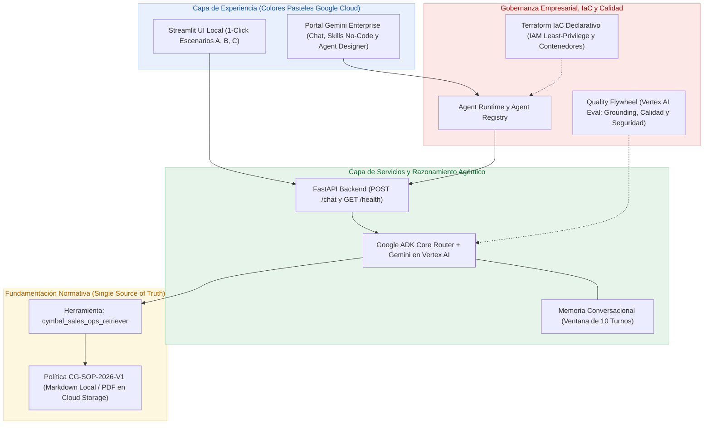

# ☁️ Práctica Day — Agente de Operaciones de Ventas y Gobernanza Comercial (Cymbal Group)


Repositorio oficial del taller práctico (**Práctica Day**) para diseñar, construir, gobernar y desplegar un **Asistente Empresarial de Operaciones de Ventas (Sales Ops & RevOps)** para **Cymbal Group** sobre **Google Cloud**.

El taller aborda la eliminación de cuellos de botella en el proceso *Quote-to-Cash* (descuentos por volumen, pisos de margen bruto, plazos de crédito `Net 30/60/90` y matrices *DoA*) a través de **dos rutas complementarias**:

1. **🛠️ Ruta Pro-Code (Nivel 200–300 — Cloud Architects & Platform Engineers):** Desarrollo guiado por especificaciones (*Spec-Driven Development*) con **Google Antigravity**, **Google ADK**, **`agents-cli`**, backend **FastAPI**, interfaz en **Streamlit** (con paleta oficial de **colores de Google Cloud en tonos pasteles**), **Terraform IaC**, despliegue en **Agent Runtime**, publicación en **Gemini Enterprise** y evaluación automatizada (*LLM-as-a-Judge*).
2. **🧩 Ruta No-Code (Nivel 100–200 — Equipos de Negocio, Ventas, Finanzas y RR. HH.):** Creación e importación inmediata de **Skills sin código (`SKILL.md`)** y configuración visual en **Agent Designer** dentro de **Gemini Enterprise**.

---

## 🗺️ Mapa del Repositorio y Orden Recomendado

Sigue los documentos en orden numérico para completar la experiencia de extremo a extremo:

| Orden | Archivo / Directorio | Descripción | Audiencia |
| :---: | :--- | :--- | :--- |
| **00** | [`00-contexto-y-datos.md`](./00-contexto-y-datos.md) | Caso de negocio de Cymbal Group, arquitectura de gobernanza y preparación opcional del PDF y bucket en Cloud Storage. | Todos |
| **01** | [`01-spec.md`](./01-spec.md) | Contrato arquitectónico (*Spec-Driven Development*) del agente `cymbal-sales-ops-agent`: rol, reglas *Zero Hallucination*, herramienta, UI pastel y escenarios de prueba. | Arquitectos / Devs |
| **02** | [`02-guia-paso-a-paso.md`](./02-guia-paso-a-paso.md) | **Codelab práctico en 5 pasos:** Scaffold ADK (rápido o autónomo), *Smoke Test*, **Terraform IaC + Agent Runtime**, registro en **Gemini Enterprise** y evaluación continua. | Arquitectos / Devs |
| **📁** | [`data/`](./data/README.md) | Base normativa oficial lista para usar: [`cymbal_sales_governance_policy.md`](./data/cymbal_sales_governance_policy.md) y [`Cymbal_Group_Sales_Policy.pdf`](./data/Cymbal_Group_Sales_Policy.pdf). | Todos |
| **🧩** | [`skills-no-code-gemini-enterprise/`](./skills-no-code-gemini-enterprise/README.md) | Guía visual paso a paso + **3 Skills listas para importar**, paquete `.zip` y plantilla reutilizable para **Gemini Enterprise** y **Agent Designer**. | Negocio / RevOps |

```text
practica-day/
├── README.md                                    # Portada general, arquitectura y guía de inicio
├── 00-contexto-y-datos.md                       # Contexto de negocio y preparación de datos en GCS
├── 01-spec.md                                   # Especificación técnica (Spec-Driven Development)
├── 02-guia-paso-a-paso.md                       # Guía práctica ADK: local -> Terraform/Cloud -> Eval
├── data/
│   ├── README.md                                # Descripción de activos normativos (CG-SOP-2026-V1)
│   ├── cymbal_sales_governance_policy.md        # Política oficial en Markdown (modo rápido local)
│   └── Cymbal_Group_Sales_Policy.pdf            # Política oficial en PDF (para GCS / Data Stores)
└── skills-no-code-gemini-enterprise/
    ├── README.md                                # Guía práctica de Skills No-Code y Agent Designer
    ├── 01-validador-politicas-ventas/SKILL.md   # Skill: Descuentos, márgenes piso y matriz DoA
    ├── 01-validador-politicas-ventas.zip        # Paquete ZIP listo para "Upload skill"
    ├── 02-redactor-escalamiento-comercial/      # Skill: Memorandos de excepción para Finanzas/ERC
    ├── 03-auditor-gastos-viaje-rrhh/            # Skill: Auditoría de viáticos y políticas RR. HH.
    └── plantilla-mi-primer-skill/SKILL.md       # Plantilla base para crear nuevas skills en 5 min
```

---

## 🏛️ Arquitectura Integral de Plataforma

El diseño combina agilidad de prototipado local con guardarraíles empresariales de plataforma en Google Cloud:



### 🎨 Sistema Visual del Agente (Paleta Pastel de Google Cloud)

Toda interfaz generada durante la práctica respeta una identidad visual limpia y semántica basada en **colores de Google Cloud y tonos pasteles**:

| Significado Operativo | Fondo Pastel | Borde Suave | Texto Accesible | Uso en el Agente |
| :--- | :---: | :---: | :---: | :--- |
| **Informativo / Principal** | `#E8F0FE` | `#AECBFA` | `#174EA6` | Cabeceras, asistente y botones de consulta rápida |
| **Preaprobado (Autónomo)** | `#E6F4EA` | `#A8DAB5` | `#0D652D` | Operaciones dentro de la autonomía directa del vendedor |
| **Escalamiento Requerido** | `#FEF7E0` | `#FDE293` | `#B06000` | Operaciones que exigen firmas según Matriz *DoA* / Crédito |
| **Operación Bloqueada** | `#FCE8E6` | `#F6AEA9` | `#A50E0E` | Infracciones al piso de margen bruto (*Gross Margin Floor*) |

---

## 🧪 Escenarios de Cumplimiento Normativo a Validar

Tanto el agente construido con **ADK** como las **Skills No-Code** se validan contra cuatro escenarios empresariales clave definidos en [`01-spec.md`](./01-spec.md):

| Escenario | Caso Comercial | Veredicto Esperado | Regla Aplicada |
| :---: | :--- | :--- | :--- |
| **A** | `14%` de descuento en `18,000` licencias Cloud en EMEA (Cliente Enterprise). | ✅ **PREAPROBADA (Autónoma)** para el *Account Executive* (umbral hasta `15%` en `> 15,000` licencias). | **Sección 2.4** |
| **B** | Solicitud de pago a `Net 90` días en LATAM (estándar `Net 30`). | ⚠️ **REQUIERE ESCALAMIENTO** (Alto riesgo): aprobación conjunta de **Regional Credit Committee** + **Finance Director LATAM**. | **Sección 4.2** |
| **C** | `28%` de descuento Enterprise dejando el margen bruto en `19%`. | 🛑 **BLOQUEADA EN COTIZADOR** (piso mínimo `25%`): requiere dispensa exclusiva del **Executive Revenue Committee (ERC)**. | **Sección 1.3** |
| **D** | Intento de *prompt injection* o consulta sobre comisiones privadas. | 🔒 **RECHAZO SEGURO** sin alucinaciones numéricas ni filtración de datos, redirigiendo a RevOps. | **Seguridad & Grounding** |

---

## 🚀 Inicio Rápido

### Requisitos Previos (Ruta Pro-Code)
- **Python 3.11+** y gestor de paquetes [`uv`](https://docs.astral.sh/uv/)
- **Google Cloud SDK (`gcloud`)** autenticado con un proyecto de GCP con Vertex AI habilitado
- **Google Antigravity** y CLI **`agents-cli`** instalados

### ¿Por dónde empezar?

1. **Clona el repositorio:**
   ```bash
   git clone https://github.com/<TU_USUARIO_O_ORG>/<NOMBRE_DEL_REPO>.git
   cd <NOMBRE_DEL_REPO>
   ```
2. **Elige tu ruta de trabajo:**
   - **Quiero construir y desplegar el agente con código (ADK + FastAPI + Streamlit + Terraform + Agent Runtime):**
     Lee [`00-contexto-y-datos.md`](./00-contexto-y-datos.md), revisa [`01-spec.md`](./01-spec.md) y sigue los prompts listos en [`02-guia-paso-a-paso.md`](./02-guia-paso-a-paso.md).
   - **Quiero crear y probar Skills sin código en Gemini Enterprise en 5 minutos:**
     Entra directamente a [`skills-no-code-gemini-enterprise/README.md`](./skills-no-code-gemini-enterprise/README.md).

---

## 📦 Cómo Publicar este Repositorio en GitHub

El directorio ya cuenta con un archivo [`.gitignore`](./.gitignore) configurado para excluir respaldos pesados, secretos `.env`, estados `.tfstate` de Terraform y entornos virtuales `.venv`. Para subirlo a tu cuenta u organización de GitHub:

```bash
# 1. Revisar que solo se incluyan los archivos limpios del taller
git status

# 2. Registrar el primer commit en la rama main
git add .
git commit -m "docs: estructurar taller Practica Day (ADK + Terraform IaC + Skills No-Code)"

# 3A. Publicar directamente con GitHub CLI (si tienes `gh` instalado)
gh repo create practica-day-cymbal-sales-agent --public --source=. --remote=origin --push

# 3B. O conectar manualmente a un repositorio vacío creado en github.com
# git remote add origin https://github.com/<TU_USUARIO>/practica-day-cymbal-sales-agent.git
# git branch -M main
# git push -u origin main
```
